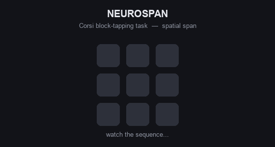

# TLS Cognitive Battery

**EEG-synced cognitive battery built with PsychoPy** — Corsi block-tapping task
(visuospatial span) and a math/operation-span task (verbal working memory),
run back-to-back as a single session with Lab Streaming Layer (LSL) event
markers for EEG synchronization.



*(illustrative mock-up of the task flow, not a screen capture)*

## Structure

```
main.py                   # entry point: runs both tasks through a PsychoPy Session
corsi/                     # Corsi block-tapping task (PsychoPy Builder: .psyexp + generated .py)
  3rdtask.psyexp
  3rdtask.py
  corsi_conditions.py      # condition generator
  corsi_conditions.csv
math_task/                 # math / operation-span task
  math_task.psyexp
  math_task.py
  make_conditions.py       # condition generator (equations, 40 trials)
  conditions.csv
assets/                     # README media
data/                       # output of runs through main.py (git-ignored)
```

## Requirements

- Python 3.10
- [PsychoPy](https://www.psychopy.org/) 2026.1.3

```bash
pip install -r requirements.txt
```

## Running

```bash
python main.py
```

A dialog asks for `participant` and `session`, then both tasks run in turn —
task order alternates by participant number parity. Results (csv/log/psydat)
are saved under `data/` and are git-ignored, since they may contain
participant data.

## Design notes

- **Corsi block-tapping task** — a sequence of grid cells lights up; the
  participant reproduces it in order. Classic measure of visuospatial span.
- **Math span task** — a three-term equation is shown, followed by a probe
  result the participant must accept or reject. Trials are generated with a
  fixed seed and a controlled distractor distance (`make_conditions.py`),
  grouped by equation complexity for analysis.
- **EEG integration** — an LSL outlet streams event markers (equation onset,
  probe onset, match/mismatch) for alignment with concurrently recorded EEG.

## Generating conditions

- `math_task/make_conditions.py` → `math_task/conditions.csv`
- `corsi/corsi_conditions.py` → `corsi/corsi_conditions.csv`
